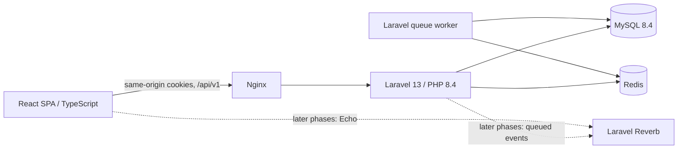

# WebRchat architecture · Phase 1

This release is the runnable foundation, not a completed chat product. Authentication and chat routes intentionally do not exist yet. No messages, identities, or contact lists shown by the UI are fabricated. The workspace reports actual API readiness.

## Boundaries

The Vite development server proxies `/api` and `/sanctum` to Nginx. Production serves compiled React assets and forwards those paths to PHP-FPM. This keeps the intended Sanctum SPA authentication same-origin. Axios sends cookies and the XSRF header; there are no bearer tokens or authentication values in browser storage. Session cookies are HTTP-only and use SameSite=Lax; HTTPS deployments must enable secure cookies. Phase 2 will add CSRF initialization, auth endpoints, verification, policies, protected routes and login throttles.

Backend structure uses Laravel's standard application, HTTP, model, policy, event and job boundaries. Add domain actions/services when a use case needs a transaction rather than introducing empty abstractions. Frontend transport is in `src/lib`, preferences in `src/store`, and routes in `src/App.tsx`. Move feature code into feature directories as those phases are implemented.

Sanctum, Reverb and Predis are installed as infrastructure. Reverb accepts no application channels in Phase 1; channel authorization denies by default. Echo and message subscribers belong to Phase 5. A Reverb port probe is only process liveness, not proof of messaging behavior. Queue health checks measure backlog connectivity; queue execution is verified separately during setup.

## Data model

| Tables | Purpose / constraints |
| --- | --- |
| users, roles, user_roles | Soft-deleted identities, suspension and verification fields; unique role membership |
| conversations | Direct or group; sorted direct-user pair unique at the database layer |
| conversation_participants | Unique membership and owner/admin/member role, notification preferences, joined/left times |
| messages | Sender-scoped unique client UUID for retries; `(conversation_id, id)` cursor index; same-conversation reply FK; soft deletion |
| message_attachments | Private storage paths, original names, detected MIME, byte sizes, image/file/voice kind |
| message_reactions | Unique message/user/emoji combination |
| message_reads | Unique message/user receipt, delivered and read timestamps |
| user_blocks | Unique directional block; cannot block self |
| user_reports | Reported user/message reference, reporter, review state and assigned moderator |
| notifications | Laravel database notification shape with explicit user FK |
| audit_logs | Actor, action, subject identifier, metadata, request ID; no default message content |
| platform_settings | Typed JSON values for future admin-managed settings |

Laravel's password reset, sessions, jobs, failed jobs and cache tables support infrastructure. Sanctum's token migration is supplied by the package but Phase 2 will use SPA cookies. No public attachment symlink is created. Database checks enforce ordered direct pairs and matching direct/group structure. Reply references use a composite FK so replies cannot cross conversations. MySQL migration tests are required because SQLite cannot represent every MySQL behavior.

Soft deletes preserve references. Hard-deletion/retention workflows must deliberately remove dependent data in a transaction. Participant membership, group ownership transitions, block enforcement, read permissions and attachment authorization require future policies/actions; a foreign key alone is not authorization. Reads must use membership-scoped queries with eager loading. History will use a stable message ID cursor within a conversation; no offset pagination. Persist before dispatch, dispatch after transaction commit, and deduplicate on sender/client UUID. A retry with a UUID but different content or conversation should be a conflict rather than returning unrelated content.

## Privacy and moderation

Administrators must not receive implicit membership or arbitrary message-read privileges. A future report permits a moderator to review only the specifically reported content through an audited, report-scoped policy. Record moderator, report ID, action, reason and time; limit retention and avoid copying entire conversations to audit metadata. Resolve report state with an explicit action. Private channels, downloads, edits and deletions must authorize independently. Suspension revokes sessions and prevents writes in Phase 2/9.

## Subsequent phases

2. Authentication, profiles, roles, verification, recovery and session management.
3. Responsive chat dashboard, navigation and user-facing loading/empty/error states.
4. Authorized direct messaging, REST Resources/Form Requests, idempotency, cursors.
5. Authorized private/presence channels, Echo, delivery, typing, reconnect/retry and receipts.
6. Groups, owners/admins, membership transitions and notifications.
7. Private validated uploads, image/file/voice playback, reactions, reply/edit/delete.
8. Search, notifications, blocking and reports.
9. Aggregate admin statistics, settings, scoped moderation and audit UI.
10. Full functional/E2E coverage, abuse controls, load tests, backups and deployment review.

The realistic 20-user/1,000-message demo dataset belongs with implemented messaging; it must be guarded to local/testing. Phase 1 seeds only the admin/user role vocabulary, without privileged users or passwords. Guest means an unauthenticated visitor and is not a database role.
